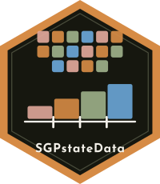

```{=html}
<section class="pkg-hero" aria-labelledby="pkg-name">
  
  <div>
    <p id="pkg-name" class="pkg-name" role="heading" aria-level="1">SGPstateData</p>
    <p class="pkg-tagline">State Assessment Program Meta-Data for the SGP Package</p>
    <ul class="pill-links">
  <li><a href="https://github.com/CenterForAssessment/SGPstateData">GitHub</a></li>
  <li><a href="articles/Specifications.html">Specifications</a></li>
  <li><a href="reference/index.html">Reference</a></li>
    </ul>
  </div>
</section>
```


SGPstateData is an environment (an **R** object of class environment) embedded as part of the [SGP package](https://sgp.io) containing information on state assessment
programs, organized by state. The environment contains, for example, achievement level cutscores and labels for the state assessments, assessment name and
abbreviation, growth cutscores and labels, information on vertical scaling, and knots and boundaries used for SGP analyses at the state level. The cutscores,
in particular, are used to calculate growth-to-standard/projection values. States included in the data set include:

* Arkansas (AR)
* Arizona (AZ)
* California (CA)
* Colorado (CO)
* Connecticut (CT)
* District of Columbia (DC)
* Georgia (GA)
* Hawaii (HI)
* Iowa (IA)
* Idaho (ID)
* Illinois (IL)
* Indiana (IN)
* Kansas (KS)
* Kentucky (KY)
* Maine (ME)
* Massachusetts (MA)
* Maryland (MD)
* Michigan (MI)
* Minnesota (MN)
* Mississippi (MS)
* Missouri (MO)
* Nebraska (NE)
* Nevada (NV)
* New Hampshire (NH)
* New Jersey (NJ)
* New Mexico (NM)
* New York (NY)
* Oregon (OR)
* Rhode Island (RI)
* South Dakota (SD)
* Utah (UT)
* Vermont (VT)
* Virginia (VA)
* Washington (WA)
* West Virginia (WV)
* Wisconsin (WI)
* Archdiocese of Baltimore (AOB)
* Colorado English Language Assessment (CELA)
* Demonstration (DEMO)
* Australia NAPLAN (NAPLAN)
* Guatemala (GUA)
* New Haven (NEW\_HAVEN)
* Renaissance Learning Inc (RLI)
* World Class Instructional Design and Assessment (WIDA)
* PARCC (PARCC)
* SBAC (SBAC)

To have your organization's data added don't hesitate to write or set up an [issue on GitHub](https://github.com/CenterForAssessment/SGPstateData/issues).


# SGP Resources

* [SGP GitHub Pages](https://sgp.io)
* [CRAN Repo](https://CRAN.R-project.org/package=SGP)
* [Norm- and Criterion-Referenced Student Growth](https://github.com/CenterForAssessment/SGP_Resources/blob/master/articles/Betebenner_EMIP_2009.pdf)


# Contributors

SGPstateData is crafted with :heart: by:

* [Damian Betebenner](https://github.com/dbetebenner)
* [Adam VanIwaarden](https://github.com/adamvi)
* [Dozens of state/organziation data analysts](https://sgp.io/authors.html)

We love feedback and are happy to answer questions.

